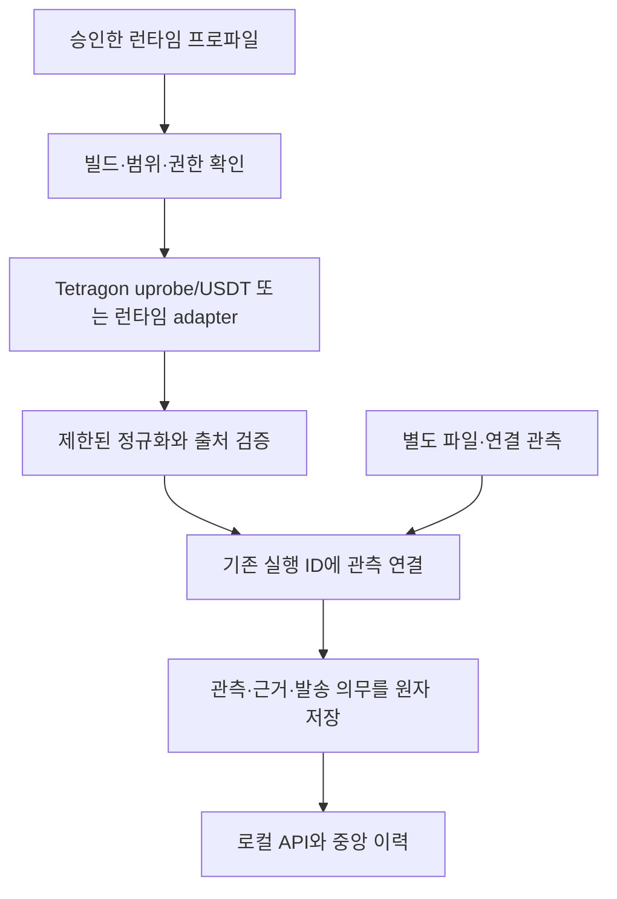

# 기존 프로세스 내부 코드 실행 관측 설계

## 목적과 현재 상태

이 문서는 새 프로세스 실행 없이 PHP/JVM/Python/Node 프로세스 안에서
컴파일·로딩·실행되는 코드를 어떻게 제한적으로 관측할지 정한다.
설계 단계이며 런타임 센서가 구현되거나 운영 환경에서 검증되었다는 뜻은 아니다.
계약은 이번 실행·파일·TCP 관측 보강과 공유 protocol `v0.1.2`를 기준으로 한다.
런타임 센서 구현을 시작할 때 최종 병합 소스와 protocol pin을 다시 확인한다.

진행 순서는 비셸·정확한 인라인 인자 관측 강화 → 파일/네트워크 후속 행위
관측 → 런타임별 선택 계측이다. 파일 쓰기나 외부 연결은 침해의 후속 근거가
될 수 있지만, 그 자체로 내부 코드 실행이나 공격 성공을 증명하지 않는다.
파일·연결·새 exec가 없는 순수 메모리 작업은 커널의 해당 행위 센서에 나타나지
않는다. 런타임 센서를 붙여도 선택한 API를 거치지 않는 실행까지 보장하지 않는다.

완료 단위는 **런타임 이름 전체**가 아니라 `프로파일 + 정확한 빌드 + 대상
서비스 + 관측 단계 + 검증 시나리오`다. `compiled`, `loaded`, `execution_entered`,
`returned`, `failed`를 구분하며 파싱·클래스 로드를 실행 완료로 표시하지 않는다.
관측은 모두 detection-only다. 이 기능이 기존 종료 허용이나 중앙 정책을 바꾸지 않는다.

## 현재 코드에서 이어야 할 경계

- `internal/collector/tetragon_observations.go`는 허용한 고정 정책의 인라인 옵션,
  파일 쓰기와 TCP 시작 이벤트를 정규화한다. 런타임 uprobe/USDT는 아직 지원하지
  않으므로 정책만 추가해서 런타임 관측이 생기지는 않는다.
- `internal/agent/operation_events.go`는 행위 스냅샷을 기존 boot/exec 키에 연결한다.
  내부 함수 진입을 새 exec로 변환하거나 실행 중인 PID의 현재 소유자를 바꾸면 안 된다.
  정확한 실행 identity가 없는 문맥은 미상으로 둔다.
- `internal/agent/tetragon_context.go`는 새 행위에 서비스 출처 보존 조건을 적용해
  기존 셸 실행파일 필터와 분리한다. 런타임 관측도 선택한 서비스 출처 검증을 거쳐야 한다.
- `internal/detection/engine.go`는 `process.exec`와 `process.exec_observation`을 평가한다.
  새로운 런타임 관측값 저장과 별도 탐지 규칙 구현은 각각 검증해야 한다.
- `internal/storage/process_context.go`는 행위 문맥과 exec/exit 생명주기 저장을 분리한다.
  런타임 사건도 불완전한 스냅샷으로 정확한 StartTime/ExitedAt/출처를 덮지 않도록
  같은 경계를 사용한다. 기존 FirstSeen ≤ LastSeen 검사를 유지한다.
- `internal/agent/runtime_capabilities.go`는 exec·파일·TCP·인터프리터 수신 증거를
  각각 기록한다. 어느 증거도 미래 런타임 후크의 활성 증거로 재사용하지 않는다.

## 증거 단계와 기본 수집 범위

| 관측 | 알 수 있는 것 | 보장하지 않는 것 |
| --- | --- | --- |
| 파일 쓰기/이름 변경/실행 가능 매핑 등 선택한 커널 동작 | 해당 프로세스가 선택 범위의 파일 행위를 시도/완료했는지 | 어떤 PHP/Java 코드가 원인인지, 그 코드가 악성인지 |
| 선택한 connect/연결 완료·실패 이벤트 | 프로세스의 대상 주소·포트와 연결 결과 | HTTP 요청 본문, TLS 평문, 요청 사용자 또는 내부 코드 실행 |
| 런타임 compile/load 이벤트 | 문자열 컴파일 또는 클래스/스크립트 로딩 경계에 도달 | 해당 코드의 실행, 결과, 공격 성공 |
| 승인한 실행 진입 후크 | 선택한 코드/메서드 실행 경계에 진입 | 전체 명령 수행 완료, 다른 런타임/네이티브 코드의 전면 감시 |
| 런타임 사건 + 같은 프로세스의 후속 파일/연결 | 시간·실행 ID가 맞는 사건들의 상관관계 | 같은 요청의 인과관계. 요청 상관 ID가 없으면 프로세스 수준으로 표시 |

초기에는 파일 내용, 네트워크 payload, 스크립트 본문, bytecode, 함수 인자·반환값,
환경 변수, URI/query/header, 예외 메시지·전체 스택을 읽거나 전송하지 않는다.
파일 경로·클래스명·소스명도 민감할 수 있어 서비스별 허용한 범위/분류만 남긴다.
동적 소스의 단순 SHA-256도 짧은 비밀값을 대입해 확인할 수 있으므로 기본적으로
저장하지 않는다. 신뢰한 설치 파일의 빌드 식별자/바이너리 digest는 별도 항목이다.

## 런타임별 관측 후보와 제한

### PHP / Zend

공식 PHP DTrace/USDT 표에는 요청 경계, compile-file, execute, function 등의
프로브가 있다. PHP를 `--enable-dtrace`로 빌드하고 대상 프로세스에서
`USE_ZEND_DTRACE=1`을 적용해야 하는 조건이 있다. Linux의 bpftrace 사용 예도
공식 문서에 있다. compile-file은 eval 문자열 컴파일의 전용 증거가 아니다.
[PHP 프로브 문서](https://www.php.net/features.dtrace.dtrace.php),
[PHP bpftrace 문서](https://www.php.net/manual/en/features.dtrace.bpftrace.php)

설계 선택:

1. 이미 승인된 빌드에 존재하는 USDT를 먼저 조사한다. 파일/함수 인자는 수집하지
   않고 고정 probe ID·프로세스·시각 중심으로 시작한다. FPM master/worker와
   mod_php의 실제 매핑 파일을 구분하고 CLI에서 성공한 결과를 FPM으로 일반화하지 않는다.
2. 동적 문자열 컴파일을 구분해야 하면 버전별 Zend 확장을 별도 제공한다.
   `zend_compile_string`은 함수 포인터이므로 그 변수 이름을 실행 함수로 생각해
   uprobe를 걸지 않는다. 실제 `compile_string` 코드 위치 또는 확장의 래퍼가 대상이다.
   PHP 8.4.0 소스의 `zend_eval_stringl`은 문자열 컴파일 후 별도 실행 경로로 이어진다.
   컴파일 성공 이벤트와 실행 진입 이벤트를 따로 검증한다.
   [PHP 컴파일 인터페이스](https://raw.githubusercontent.com/php/php-src/php-8.4.0/Zend/zend_compile.h),
   [PHP eval 경로](https://raw.githubusercontent.com/php/php-src/php-8.4.0/Zend/zend_execute_API.c)
3. Zend Observer의 함수 진입/종료 등록은 확장의 startup/MINIT에서 한다.
   이것이 모든 eval/OPcache/JIT 경로를 관측한다는 가정은 하지 않는다. eval opcode
   배열과 선택 함수의 실제 진입이 모두 확인된 프로파일만 execution 단계로 올린다.
   [Zend Observer 인터페이스](https://raw.githubusercontent.com/php/php-src/php-8.4.0/Zend/zend_observer.h)

프로파일은 PHP minor/patch 및 vendor build, 확장 API/build ID, ZTS/NTS,
debug/non-debug, 아키텍처, FPM/Apache/CLI, OPcache/JIT와 다른 확장 조합에 묶는다.
예제 참조 태그는 운영에 권장하는 패치 버전이 아니다. 바이너리 교체·확장 ABI
불일치 시 이전 오프셋을 적용하지 않고 unavailable로 되돌린다.

모든 함수/라인 USDT는 트래픽에 비례해 매우 많은 이벤트를 만들 수 있다.
선택 서비스와 승인한 경계만 사용하고, 템플릿 엔진·정상 eval·프레임워크
캐시 생성을 단독 고위험 탐지로 만들지 않는다. 본문이나 PHP 변수는 수집하지 않는다.

### Java / JVM

`-javaagent` 또는 JVMTI agent를 애플리케이션 시작 시 명시적으로 로드하는 방식을
우선한다. `ClassFileLoadHook`은 메모리 클래스 표현을 만들기 전의 클래스 데이터
경계이며 실행 증거가 아니다. 실행 진입이 필요하면 좁은 메서드 집합에 대한
bytecode 계측을 별도 검증한다. 전역 MethodEntry/MethodExit는 공식 명세에서도
성능 저하를 경고한다.
[JVMTI 명세](https://docs.oracle.com/en/java/javase/25/docs/specs/jvmti.html),
[Java Instrumentation](https://docs.oracle.com/en/java/javase/25/docs/api/java.instrument/java/lang/instrument/package-summary.html)

설계 선택은 class-loader/코드 출처의 승인 여부, 클래스 로드·재정의 구분,
선택 메서드 진입의 고정 ID를 수집하는 것이다. 클래스 bytes/constant pool,
인자와 반환값은 전송하지 않는다. 클래스 로딩에 쓰인 이름이 null인 경우도 미상으로
처리한다. 프록시·람다·JSP·플러그인·동적 프레임워크는 정상 로딩을 많이 만든다.

HotSpot/OpenJ9 등 구현, JDK 17/21/25 후보별 지원 capability와 class-file 버전,
모듈 경계, 다른 javaagent와 변환 순서, JIT/재변환, virtual thread를 각각 시험한다.
virtual thread/비동기 작업은 OS TID와 같은 수명·귀속을 가진다고 가정하지 않는다.
기존에 로드된 클래스와 이미 실행 중인 프레임은 사후 attach가 완전히 복원하지 못한다.

Attach API의 구현별 조건과 JDK의 동적 agent 로딩 제약도 별도 확인한다.
JDK 21의 경고와 JDK 25의 명시적 opt-in 설명 때문에 운영 중 JVM에 자동 attach하거나
경고를 숨기는 플래그를 몰래 추가하는 흐름을 만들지 않는다. HotSpot 내부 C++ 심벌의
uprobe/선택적 USDT는 정확한 vendor build에 한정한 실험 후보이며 기본 경로가 아니다.
[JDK Attach API](https://docs.oracle.com/en/java/javase/25/docs/api/jdk.attach/com/sun/tools/attach/VirtualMachine.html),
[JDK 21 변경 사항](https://www.oracle.com/java/technologies/javase/21-relnote-issues.html)

### CPython

CPython 3.8+ audit 이벤트의 `compile`, `exec`, `import`, `code.__new__` 등을
서로 구분한다. compile의 source와 exec의 code object는 민감한 입력이므로
콜백에서 직렬화하지 않는다. 파일/소켓 audit 이벤트는 런타임 API 호출 근거이며
커널 센서의 실제 성공 결과와 동일하게 취급하지 않는다.
[CPython audit 이벤트 표](https://docs.python.org/3.12/library/audit_events.html)

Python 수준 `sys.addaudithook`은 간단한 선택 계측에 쓸 수 있지만 보안 경계가
아니고 우회될 수 있다. 더 강한 배치를 선택한다면 런타임 초기화 전 native
`PySys_AddAuditHook`을 등록한 승인된 launcher/embedding 구성이 필요하다.
일반 실행 중인 python에 확장을 import했다는 사실만으로 그 조건이 충족되지는 않는다.
[sys audit hook 설명](https://docs.python.org/3.12/library/sys.html#sys.addaudithook),
[native audit hook API](https://docs.python.org/3.12/c-api/sys.html#c.PySys_AddAuditHook)

3.12+의 `sys.monitoring`은 선택 code object의 PY_START/PY_RESUME 등 실행
이벤트를 추가로 관측할 후보다. 모든 LINE/INSTRUCTION 이벤트를 기본 활성화하지
않고 다른 도구와 tool ID 충돌을 검사한다. 이는 PyPy 등 다른 구현에 대한 약속이 아니다.
[CPython monitoring API](https://docs.python.org/3.12/library/sys.monitoring.html)

외부 USDT는 `--with-dtrace` 빌드/실제 `.note.stapsdt`를 확인한다. shared build이면
실행 파일 외 libpython도 확인해야 한다. 공식 문서도 CPython 버전 간 프로브
호환성을 보장하지 않는다. `_PyEval_EvalFrameDefault` 같은 내부 심벌에 고정된
프로파일은 minor 변경, 최적화·JIT·free-threaded 빌드에서 별도 검증한다.
[CPython 정적 프로브](https://docs.python.org/3.12/howto/instrumentation.html)

정상 import/템플릿·직렬화·노트북·플러그인의 동적 코드와 구분하려면 출처 및
후속 행위가 필요하다. `exec` 계열 후크도 기존 함수 객체 호출이나 native 확장의
모든 실행을 뜻하지 않는다. 코드 내용을 수집하지 않는 이상 악성 코드의 의미를
완전히 판정할 수 없으며 프로세스 침해 이후 hook 자체도 신뢰 증명이 아니다.

### Node.js / V8

승인된 애플리케이션 adapter가 관리하는 vm/플러그인 로더의 실행 경계를
우선 대상으로 한다. `node:diagnostics_channel`은 발행자가 만든 진단 채널이지
모든 eval을 자동 통지하는 보편 센서가 아니다.
[Node 진단 채널](https://nodejs.org/api/diagnostics_channel.html)

`inspector.Session().connect()`로 같은 프로세스의 V8 알림을 관측하는 실험은
가능하다. `Debugger.scriptParsed`는 파싱 알림이고 debugger 활성화 시 과거
스크립트도 다시 보고되므로 새로운 실행으로 세지 않는다. 컴파일과 나중 실행을
분리하고, 통제한 loader 진입을 확인했을 때만 execution 단계로 표시한다.
[Node 22 Inspector](https://nodejs.org/docs/latest-v22.x/api/inspector.html),
[공식 V8 Inspector protocol 정의](https://raw.githubusercontent.com/ChromeDevTools/devtools-protocol/master/json/js_protocol.json),
[Node vm 설명](https://nodejs.org/api/vm.html)

프로파일은 Node major/patch·V8 버전·아키텍처와 Worker/isolate 범위를 포함한다.
하나의 session으로 모든 Worker를 관측했다고 표시하지 않는다. `eval`, Function
생성자, vm, module loader, cached script, Wasm, native addon은 서로 다른 시험
항목이다. 공개 vm API를 감싼 adapter만으로 직접 eval이나 모든 native 실행이
포함되지는 않는다. JIT된 기계어 주소는 재컴파일·이동 때문에 범용 uprobe 대상이 아니다.

기본 경로는 inspector TCP 포트를 열지 않는다. `Runtime.evaluate`, source 조회,
heap snapshot, breakpoint/pause, network body 조회는 수집 API에서 사용하지 않는다.
원격 debugger는 애플리케이션을 제어할 수 있는 별도 권한이므로 이 관측 기능과
결합하지 않는다. URL/sourceMapURL/파싱 오류 메시지도 기본 이벤트에서 제외한다.

## 공통 센서·프로파일 계약

Linux uprobe는 대상 파일과 코드 offset을 기준으로 한다. 실제 실행 중인
이미지/라이브러리와 manifest의 digest를 맞춘 후 적용해야 하며, 심벌 이름이나
버전 문자열 하나만으로 오프셋·인자 ABI를 신뢰하지 않는다.
[Linux uprobe 인터페이스](https://docs.kernel.org/trace/uprobetracer.html)

고정 Tetragon v1.8.0에는 uprobe/USDT 스펙과 이벤트 종류가 존재한다. UProbeSpec의
binaryDigests와 policy status를 활용할 수 있다. USDT에는 별도 Path/Provider/Name이
있으므로 uprobe 옵션을 그대로 복사하지 않는다. 설치된 센서와 실제 출력 fixture로
확인하며 최신 웹 문서의 새 필드를 무조건 v1.8.0 정책에 넣지 않는다.
[v1.8.0 정책 타입](https://raw.githubusercontent.com/cilium/tetragon/v1.8.0/pkg/k8s/apis/cilium.io/v1alpha1/types.go),
[v1.8.0 이벤트 정의](https://raw.githubusercontent.com/cilium/tetragon/v1.8.0/api/v1/tetragon/events.proto)

프로파일 manifest의 필수 내용은 profile ID/revision, 런타임 family·빌드 digest,
아키텍처/ABI, 대상 서비스·cgroup, 매핑 파일 identity, 후크 ID/단계, 인자 schema,
허용 필드·보존 한도, 무해 self-test와 기대 결과, 측정 성능 예산이다. 자동 심벌
추측·미검증 메모리 offset 읽기·정책의 임의 코드/메모리 값 변경은 허용하지 않는다.
허용 동작은 관측용 Post뿐이며 Signal/Override/Set 등 변경 동작은 넣지 않는다.

커널/SELinux/lockdown/namespace/perf/BPF 권한, USDT semaphore 및 container의
실제 mapped inode도 확인한다. CAP_PERFMON의 perf 권한 설명이 Tetragon 전체의
필요 권한을 보장하지는 않는다. 이 기능을 위해 보안 정책을 끄거나 커널 전역의
perf 설정을 완화하지 않는다. 런타임 내 API 계측은 kernel BTF 유무와 별도 진단한다.
[Linux perf 보안 모델](https://docs.kernel.org/admin-guide/perf-security.html)

### 데이터 흐름과 신뢰

런타임 adapter는 애플리케이션 권한으로 실행한다. 새 전용 Unix 수신 경계에서
SO_PEERCRED의 실제 peer PID/UID와 boot/start identity·허용 서비스를 확인한다.
payload가 주장하는 PID를 인증으로 사용하지 않는다. 기존 root 전용 audit ingest의
권한을 낮춰 재사용하지 않는다. 앱과 같은 권한의 센서가 보내는 내용은 해당 앱이
변조할 수 있으므로 kernel 관측과 다른 출처/신뢰 수준으로 표시한다.

콜백은 비차단 전송과 bounded queue를 사용하며 앱의 실행을 중단하지 않는다.
초기 설계 예산은 이벤트 16 KiB, 프로세스별 128개 대기, 호스트별 4 MiB 대기,
선택 경계별 rate limit 및 샘플링/drop counter다. 수치는 구현 전 부하 시험으로
조정할 수 있지만 무제한 fallback이나 본문 캡처로 바꾸지 않는다. 유실/샘플링은
일반 관측과 구분해 기록하고 탐지 없음으로 해석하지 않는다.

정규화 payload 제안은 고정 enum의 runtime family, profile revision, phase,
hook ID, runtime instance ID, 불투명 code/class ID, 선택 범위, outcome,
출처 신뢰 수준이다. source EventTime와 IngestTime을 분리하고 관측 구간은 ingest
시각의 min/max로 유지한다. 소스가 알린 시작·종료 시각은 보정하지 않는다.
요청 귀속은 명시적으로 전파한 불투명 상관 ID가 있을 때만 표시한다. PHP worker,
JVM thread, Python asyncio, Node event loop의 PID/TID만으로 요청을 확정하지 않는다.

## Capability와 검증 상태

`observation.runtime.php.dynamic_compile`, `...php.dynamic_execute`,
`...jvm.class_load`, `...jvm.selected_method_entry`, `...python.dynamic_compile`,
`...python.code_execute`, `...node.script_compile`, `...node.selected_code_execute`
같은 별도 capability를 제안한다. 이름은 구현 시 레지스트리에서 확정한다.
각 항목은 기존 State/Implementation/RuntimeState/VerifiedAt/Details 모델을 사용하되
Details는 승인된 짧은 고정 값만 넣는다. 임의 런타임 문자열을 진단에 복사하지 않는다.

| 상태 | 진입 조건 |
| --- | --- |
| planned/inactive | 해당 런타임 adapter가 아직 구현되지 않음 |
| implemented + unavailable/unsupported 진단 | 빌드/ABI/권한/프로브가 맞지 않음. 추측 attach 금지 |
| available 또는 unverified | 지원 프로파일과 부착은 확인됐지만 대상의 실제 사건은 미수신 |
| active | 정확한 대상·후크·단계의 무해 사건을 수신하고 저장/API 확인까지 완료 |
| limited/unverified 진단 | 샘플링·누락 Worker·부분 후크·과거 baseline만 관측. 지원 범위를 함께 표시 |
| error | 실제 adapter/부착/정규화/저장 실패. 성공 상태로 덮어쓰지 않음 |

위 표의 unavailable/limited는 표시 의미이며 새 RuntimeState enum을 무조건 추가하는
제안은 아니다. 기존 wire 값으로 상태를 표현하고 고정 reason으로 구분할 수 있다.
수집 증거가 조용한 기간을 곧바로 장애로 보지 않으며 마지막 실검증 시각을 그대로
보인다. 런타임 재시작, 빌드/profile 변경, 후크 분리·reader 종료 시 active 증거를
폐기한다. PHP compile 증거로 Java 실행/파일/net capability를 활성화하지 않는다.

## 종단 wire·저장 호환성 검토

| 경계 | 현재 코드의 실제 동작 | 확장 시 조치 |
| --- | --- | --- |
| `protocol/model.Event` | SchemaVersion `0.1`, Type은 string. EventKind enum 없음 | 새 Type 값은 수용 가능하지만 의미 검증/화면 분류를 함께 구현 |
| agent의 공유 모델 | `internal/model`은 published protocol v0.1.1 alias이고 replace 없음 | 로컬 protocol 폴더 편집만으로 본체에 반영되지 않음. 모듈 발행·양쪽 pin 또는 별도 투영 경계 필요 |
| `managed.Record` | Kind는 event/finding/audit/event_bundle 4개만 허용 | 새 Record.Kind는 현재 프로토콜에서 전송 불가. event_bundle 안 확장 사용 |
| 중앙 Batch strict decode | Payload가 RawMessage라 내부 필드를 typed decode하지 않음 | outer 필드 추가와 내부 event 필드 추가의 호환성을 구분 |
| 중앙 validateRecord | 내부 payload를 map으로 재인코딩한 뒤 json.Unmarshal로 알려진 event 필드 검증. 원본 확장 필드는 저장 map에 남음 | optional event 확장 수용 가능성은 있음. 버전교차 fixture로 보존/검색/렌더링 확인 |
| Heartbeat/정책/응답 | typed struct를 DecodeStrict/DisallowUnknownFields로 해석하는 경계 존재 | 새 중첩 필드는 구버전에서 실패할 수 있음. signed policy에 임의 필드 추가 금지 |
| 로컬 정규화/SQLite | event schema equality, body 한도, 시간·ID 요구. event_type TEXT에 고정 enum 없음 | 허용 Type/typed payload 검증·PID문맥·타임스탬프·JSON round-trip 필요 |
| 발송 큐 | 프로토콜 record 최대 1 MiB, 현재 에이전트 enqueue 512 KiB, contiguous ACK | 낮은 한도에 맞춰 bounded metadata만 사용. 잘못된 한 건이 전체 batch 진행을 막는 실패 시험 |
| UI/이력 | Type string/JSON 검색 가능하나 기존 요약·라벨·조건은 exec 중심 | 타입별 제목·필드·보존 범위·미관측 표시까지 검증 |

현재 enqueue 한도 초과는 `lost_records`를 증가시키고 레코드를 발송 큐에서
생략할 수 있다. 저장 성공만으로 중앙 전달 성공을 주장하지 않으며, 별도 유실
상태·경보와 발송/ACK 확인을 완료 판정에 포함한다.

신규 optional `file`/`network`/`runtime` 구조를 설계하더라도 먼저 구/신 프로토콜,
로컬 클라이언트, 중앙 consumer의 모든 decode 경계를 시험한다. `omitempty`가
있어도 **실제로 필드가 전송되는 경우**의 strict consumer는 호환되지 않을 수 있다.
새 capability map key는 기존 Capability 필드만 사용하면 새 struct 필드와는 다르다.

`RawJSON`에 의미를 숨기면 privacy 기본값에서 삭제되므로 정규 이벤트 필드의 대체가
되지 않는다. 정책 signature를 유지한다며 unknown-field 검사를 제거하지 않는다.
먼저 local opt-in 프로파일을 사용하고, 중앙 제어가 필요해지면 버전 협상과 서명
대상 변경을 독립 설계한다. 중앙 UI의 계획 값이 구버전 에이전트에서 활성으로
보이지 않도록 unsupported/pending 처리를 유지한다.

같은 소스 사건 재시도는 동일 ID와 immutable payload를 유지한다. instance ID와
소스 sequence를 조합해 서로 다른 내부 호출을 하나로 합치지 않는다. 나중에 알게 된
파일/연결·요청 문맥은 기존 bundle의 본문을 수정하지 않고 별도 연관 관측으로 둔다.
현재 sameSourceEvent는 local Sequence/IngestTime과 Process/Ancestors의
FirstSeen/LastSeen을 제외하며, source 시간·ExitedAt·ID·인자·typed payload는
엄격 비교한다. 중앙은 재수신 payload hash도 비교하므로
동일 delivery identity에 다른 본문을 실어 보내면 spool 진행이 막힐 수 있다.

## 무해 시험과 완료 판정

시험은 격리된 테스트 서비스/컨테이너에서 한다. 운영 프로세스에 코드나 agent를
주입하지 않는다. fixture는 고정된 비밀 없는 산술/상수 반환과 loopback 연결,
임시 디렉터리 파일만 사용하고 실제 자격 증명·사용자 트래픽은 읽지 않는다.

| 시험 | 기대 결과 |
| --- | --- |
| PHP `eval`로 산술 값 반환, 정상 파일 include의 차가운/따뜻한 OPcache | compile/execute 단계 차이와 cache 누락 범위를 정확히 표시. file probe만으로 eval 실행 판정 금지 |
| JVM의 테스트 전용 class load 후 상수 반환 메서드 호출 | load 1건과 선택 메서드 진입 근거 분리. load만 구현한 프로파일은 실행 active 금지 |
| CPython의 무해 compile 후 미실행/exec 실행 쌍 | compile-only와 exec 구분. source 문자열·code bytes·변수 미저장 |
| Node vm.Script 생성 후 미실행/실행, Worker의 별도 실행 | scriptParsed와 실제 adapter 진입 구분. debugger 시작 시 과거 script는 baseline 표시 |
| 이미 실행 중인 프로세스의 loopback 연결·임시 파일 쓰기 | process.exec가 없어도 후속행위 수집. 런타임 sensor가 없으면 내부 실행 근거는 미상 |
| 메모리 안 산술만 수행하며 모든 런타임 sensor를 끔 | file/net 이벤트 없음이 정상. ‘탐지 안전/실행 없음’으로 표시하지 않음 |
| 정상 템플릿/동적 proxy/import/cache warmup | 동적 코드 단독으로 악성 확정·자동 종료하지 않음 |
| 소스 시각이 미래/역전, 중복·재시작·PID 재사용 | 안정 ID, local 시간 invariant, 기존 프로세스 종료 상태와 immutable bundle 유지 |
| 바이너리 교체·missing symbol·USDT 없음·권한 거절·센서 재시작 | stale offset attach 없음. capability 내려감과 구체적 고정 reason |
| 큐 포화·disk full·중앙 구버전/HTTP 400·reader malformed | 유실/에러가 드러남. 수집 성공으로 상태를 자동 덮지 않음 |
| payload에 시험용 비밀 marker 삽입 | source/argv/env/HTTP body/예외문이 DB·outbox·journal·API·브라우저에 남지 않음 |

프로파일별 canary에서 baseline과 계측 후 동일 요청 집합/동시성으로 p50/p95/p99,
처리량, CPU, RSS, GC/worker 재시작, 생성/보존/drop 수를 측정한다. 초기 수용 예산
제안은 p95 지연 증가 5% 이하, CPU 증가 5% 이하, 센서 추가 메모리 32 MiB 이하이며
실측 보장값이 아니다. 예산·서비스 SLO를 벗어나면 해당 프로파일을 중단하고 범위를
줄인다. 모든 함수/라인 계측을 자동 fallback으로 켜지 않는다.

완료에는 실제 target-build 시험, 필터와 coverage 명시, immutable 저장/재시도,
로컬 API와 중앙 event_bundle 조회, 개인정보 marker 검사, 손실·실패·롤백 검증,
성능 결과와 남은 blind spot 기록이 모두 필요하다. 후크 부착 성공이나 한 번의
heartbeat만으로 완료하지 않는다. 라이브러리/애플리케이션 업데이트마다 같은
프로파일의 빌드 적합성을 다시 확인한다.

## 단계별 구현 경계

1. 파일/net 관측과 Type별 보존·표시를 먼저 완성하고 단순 프로세스 상관만 제공한다.
2. 테스트 환경의 승인 빌드 한 종류에서 metadata-only 런타임 프로파일 하나를 실험한다.
   PHP USDT가 실제 제공되면 이를 먼저 검토하고, 그렇지 않으면 명시적으로 배치할 수
   있는 runtime adapter를 선택한다. 모든 서버에서 같은 수단이 가능하다고 가정하지 않는다.
3. 런타임 API/USDT가 실제 주는 compile/load 범위를 출시하고 execution 단계는 별도 gate로 둔다.
4. 정확한 버전·실행 경로가 검증된 경우에만 선택 실행 진입과 파일/net 연관을 추가한다.
5. 다른 런타임·JIT·Worker·container 조합은 각 프로파일의 반복 검증 후 추가한다.

예상 모듈은 `internal/runtimeobserve/`의 프로파일·신뢰/범위 검증,
`internal/collector/tetragon_runtime.go`의 명시적 이벤트 adapter,
`internal/agent/runtime_observation.go`의 프로세스 연결과 capability,
런타임별 별도 배포 패키지다. 실제로 필요한 단계가 되기 전에는 빈 모듈이나
일괄 의존성을 만들지 않는다. service entry에 런타임별 ABI/메모리 읽기 코드를
누적하지 않고 기존 kernel collector의 상태·롤백과 독립적으로 관리한다.
